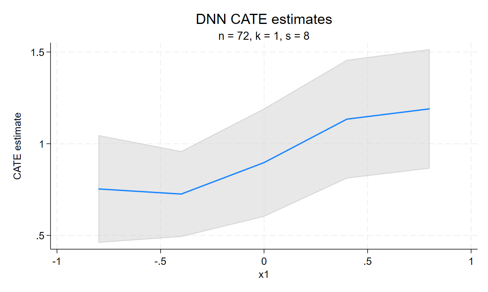

# RdistNN for Stata

Version **0.1.4**. See [release notes](RELEASE_NOTES.md) for changes.

**RdistNN for Stata** estimates conditional treatment effects and regression
functions using distributional nearest-neighbor (DNN) weights. Choose covariate
profiles, fit local estimates, and inspect jackknife standard errors, local
support and tuning sensitivity. For causal estimation, you supply nuisance
predictions; the package constructs the adjusted signals and performs local
estimation.

[Get started](docs/getting-started.md)
· [Command guide](docs/command-guide.md)
· [R companion](https://github.com/JakobJuergens/RdistNN)

## Installation

Stata **17 or later** is required:

```stata
net install rdistnn, from("https://raw.githubusercontent.com/JakobJuergens/RdistNN_stata/master/") replace
help rdistnn
```

This installs production `master`. The portable
ado/Mata implementation runs on Windows, macOS and Linux without R, Python or
a compiler. Native acceleration is optional; see the [plugin guide](src/plugin/README.md)
for platform-specific binaries.

For the version-pinned release, replace `master` with `v0.1.4` in the installation URL.

For reproducible installation, retain the full source commit or checked archive
identity; [RELEASING.md](https://github.com/JakobJuergens/RdistNN_stata/blob/master/RELEASING.md)
explains candidate installation and historical pins. The historical `v0.1.0` tag predates CLATE and
the current shared reporting interface. Retain the source commit or archive
identity alongside your results.

## Choose a workflow

| Goal | Command | Main inputs |
|---|---|---|
| Conditional average treatment effects | `cate_dnn` | Outcome, treatment and supplied outcome/propensity predictions, or a supplied pseudo-outcome |
| Conditional mean regression | `np_dnn` | Outcome and covariates |
| Conditional effects among compliers | `clate_dnn` | Outcome, binary treatment/instrument and instrument-arm nuisance predictions |
| Ratio of two local means | `clate_dnn, pseudooutcome denominator()` | Two aligned signals |
| Two-scale regression | `np_tdnn`, `weights_tdnn` | Outcome and two localization orders |
| Reusable DNN weights | `weights_dnn` | Covariates and target profiles |

Use `xcols()` for localization covariates, `x0()` for one profile or
`x0matrix()` for a matrix whose rows are profiles. Target columns follow the
order in `xcols()`.

## A first CATE fit

This self-contained simulation clears the active dataset and uses **oracle
nuisances**. In an application, replace them with aligned predictions of the
control outcome mean, treated outcome mean and treatment propensity. The
package does not fit those models.

```stata
clear
set obs 300
set seed 42
gen double x1 = rnormal()
gen double x2 = rnormal()
gen double e_oracle = invlogit(0.5*x1 - 0.5*x2)
gen byte D = runiform() < e_oracle
gen double m0_oracle = 1 + x1 - x2
gen double m1_oracle = m0_oracle + 0.5 + 0.5*sin(x1)
gen double Y = m0_oracle + D*(m1_oracle-m0_oracle) + rnormal()*0.5

matrix X0 = (-1,0 \ -0.5,0 \ 0,0 \ 0.5,0 \ 1,0)
cate_dnn Y, tcol(D) xcols(x1 x2) x0matrix(X0) ///
    ecol(e_oracle) m0col(m0_oracle) m1col(m1_oracle) tuningmode(grid)
matrix cate_summary = r(summary)
estimates store cate_fit
matrix list cate_summary
cate_dnn_diagnostics
cate_dnn_plot, type(estimates) style(profile) replace
```

Each row reports an effect, standard error and pointwise confidence bounds.
Copy `r()` results before another command replaces them; `estimates store`
keeps the fitted model for later use. The [quick start](docs/getting-started.md)
explains supplied-score inputs and saved results. Earlier `mcol()`/`mhat()`
calls should use both arm means for AIPW or a supplied `pseudooutcome`.
Refit objects from older development versions; see
[saved-fit migration](docs/reusing-fits.md#migrating-saved-cate-fits-after-robinson-removal).

## Regression and conditional LATE

For a conditional mean, reuse the same outcome, covariates and targets without
nuisance inputs:

```stata
np_dnn Y, xcols(x1 x2) x0matrix(X0)
matrix regression_summary = r(summary)
matrix list regression_summary
```

Each fit replaces the active `e()` results. Use `estimates restore cate_fit`
before CATE postestimation. The [saved-fit guide](docs/reusing-fits.md) explains
reporting, candidate extraction and prediction at new profiles.

Use `clate_dnn` for conditional LATE with a binary instrument and treatment.
Supply the instrument propensity and outcome/treatment means in each
instrument arm. The [CLATE guide](docs/conditional-late.md) and
[runnable IV example](examples/clate.do) explain the inputs, paired covariance
and status outputs. Inspect the first stage alongside the ratio; weak local
first stages can make Wald intervals unreliable.

## Reporting, plots and tuning

Replay the fitted command to change `level()` without refitting. Its matching
`_diagnostics` command reports local support, and `_plot` draws estimates,
weights, overlap and tuning comparisons. See [reporting](docs/diagnostics-and-reporting.md)
and [plotting](docs/visualising-fits.md) for selection, saving and export.
Saved estimates retain observation-level numeric data and inherit the data's
sharing restrictions.



The [diagnostics tutorial](examples/diagnostics-and-plots.do) produces this
example with oracle nuisances; its ribbon shows pointwise confidence bounds.

The default is exact DNN with `k(1)`. Larger `s()` tightens localization;
`tuningmode(grid)` compares candidate orders while retaining the default fit.
Grids are sensitivity comparisons, not automatic selection. Jackknife
uncertainty requires `s < n`; `nose` skips it. See
[weights and tuning](docs/weights-and-tuning.md) for the default rule and options.

<a id="inference-and-localization"></a>

## Interpreting inference

Intervals are **pointwise**. The framework assumes independent observations;
cluster and survey-design inference are not supplied. At each target, observations
with exactly equal represented distance under the selected metric share the
average of their assigned rank weights, including every deletion's surviving
group. Nearby distances are not merged. This includes different covariate profiles
at equal distance; individual weights, support and effective sample size can
change. Aligned row permutations preserve estimates and covariance up to numerical
precision. Refit saved objects created under an earlier tie policy.

The paper assumes a continuous distance distribution, under which the earlier
and current rules agree almost surely. Commands warn when distance ties occur:
inference for persistent distance ties is not established. Averaging does not
supply a uniform mean-squared-error improvement.

Nuisance predictions must be aligned with the estimation observations.
Propensity clipping is numerical protection, not a remedy for poor overlap.
Diagnostics describe local support; they do not establish validity. For the
identification, nuisance-learning and localization conditions and theoretical
results, see the accompanying
[paper](https://jakobjuergens.com/research/#orthogonal-inference-conditional-z).
The guides explain the corresponding inputs and outputs.

<a id="optional-native-acceleration"></a>

## Numerical behavior and engines

Ordinary use works with the portable Mata implementation. The optional plugin
accelerates distance and jackknife calculations; install the binary matching
your platform using the [plugin guide](src/plugin/README.md). Its engine
controls and the [numerical implementation reference](docs/numerical-stability.md)
are intended for performance work and troubleshooting.
Automatic fallback handles unavailable acceleration. A native execution,
resource or Break failure stops with its reported code; choose Mata explicitly
for a diagnostic rerun. The
[reporting guide](docs/diagnostics-and-reporting.md#warnings-and-failures)
explains how to inspect and handle failures.

Asymptotic Beta tables retain a known rounding limitation at extremely small
tail masses, including possible R/Stata support differences. See the
[weight guide](docs/weights-and-tuning.md#numerical-limits) before interpreting
calculations at those scales.

## Further reading and help

The [article index](docs/index.md) routes all workflows and runnable examples;
`help rdistnn` opens installed command references. The
[R crosswalk](docs/r-documentation-crosswalk.md) identifies shared and R-only
features. Experimental `plqr_dnn` evaluates moments at supplied coefficients;
it does not estimate coefficients or provide coefficient inference.

Report problems through the [issue tracker](https://github.com/JakobJuergens/RdistNN_stata/issues)
with a minimal example, Stata version, operating system and package commit.
See [CONTRIBUTING.md](https://github.com/JakobJuergens/RdistNN_stata/blob/master/CONTRIBUTING.md) for development and the
[R citation file](https://github.com/JakobJuergens/RdistNN/blob/master/inst/CITATION)
for methodological references. The license is [GPL version 3 or later](LICENSE.md)
with [additional permission to link the plugin with Stata](LINKING_EXCEPTION.md).

## Contributors

- [Jakob R. Juergens](https://jakobjuergens.com/): main package author and maintainer.
- [Zakareya Chehime](https://github.com/Zakareya-Chehime): quality assurance, testing and validation.
