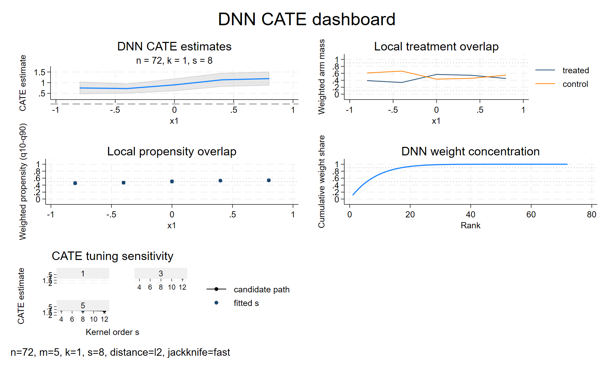
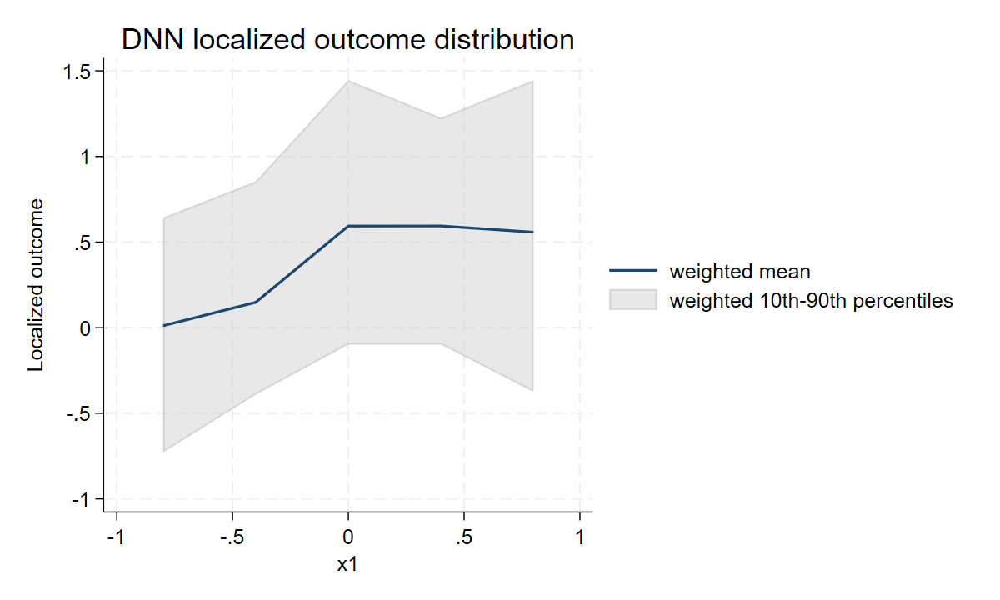
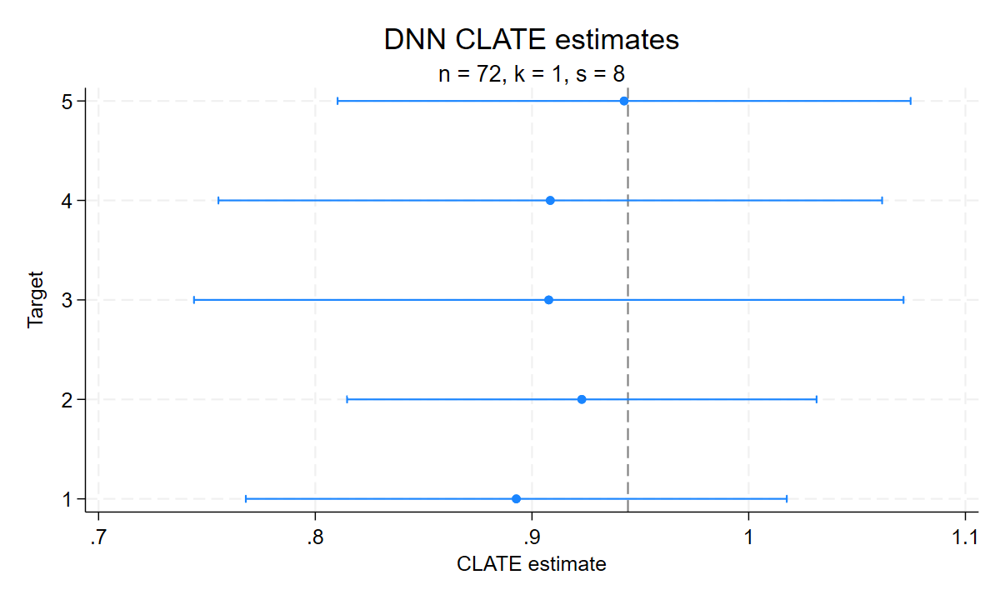

# Visualising fits

`cate_dnn_plot`, `clate_dnn_plot`, and `np_dnn_plot` turn the
active fit into Stata graphs. Choose a panel based on the question: estimates
for pointwise uncertainty, diagnostics for concentration, weights for local
geometry, overlap for arm support, influence for score contributions, and
NP outcome panels for the local outcome distribution. The commands return
numeric graph data as well as named graphs, so a report can use the precise
rows behind a panel.

The [complete example](../examples/diagnostics-and-plots.do) generates seeded
data and demonstrates common panels without GUI interaction or downloaded
inputs. See [diagnostics and reporting](diagnostics-and-reporting.md) for the
underlying quantities, [getting started](getting-started.md) for installation,
and `help rdistnn` for the installed overview.

## Gallery from the runnable example

These plots use the seeded tutorial data in
[diagnostics-and-plots.do](../examples/diagnostics-and-plots.do). They illustrate
reporting choices, not empirical evidence or nuisance-learner performance.


The CATE profile connects five target estimates along x1 with x2 held at zero.
Its ribbon is pointwise uncertainty, not a simultaneous confidence band.



This four-panel dashboard uses a standalone view of the grid's default
candidate. It places estimates beside treatment-arm mass,
propensity summaries and cumulative rank weights. The example draws tuning
comparisons separately so their target-specific paths remain readable.
These panels describe the fit; they do not verify its inference conditions.



The NP outcome band is a weighted 10th–90th percentile range. It describes
local outcome dispersion and is different from uncertainty about the mean.



The paired-signal CLATE forest plot emphasizes target identities and ratio
uncertainty. These synthetic paired signals illustrate computation; they do
not by themselves identify a causal complier effect.

## Draw an estimate panel

After a CATE batch fit:

```stata
cate_dnn_plot, type(estimates) level(90) name(cate_profile) replace nodraw
matrix figure_data = r(plot_data)
```

`type(estimates)` is the default. `level()` is a percentage, defaulting to
Stata's current `c(level)`; it recomputes normal bounds using stored SEs.
NP labels estimates as conditional means and CLATE labels them as CLATE.
Their covariance is already on the estimator scale. Intervals are pointwise,
even though the fitted covariance retains cross-target dependence.

Choose `style(profile)`, `style(forest)` or `style(pointrange)` explicitly
when needed. A profile needs an x coordinate; `xindex(j)` selects coordinate
j in `xcols()` order. A path through profiles with several varying coordinates
is not an automatically adjusted response curve. Forest plots use target IDs.

`nose` plots estimates without intervals. CATE/NP zero SEs give point bounds.
CLATE zero SEs remain in the returned data but have no Wald bounds when its
status mask rules out inference. Undefined CLATE estimates are omitted from
the graph data while their original IDs remain in full fit/diagnostic tables.
An entirely undefined selection produces a blank estimate graph,
`r(n_rows)=0`, and no `r(plot_data)` matrix. Check `r(n_omitted)` and
`r(selected_targets)` when interpreting an estimate or tuning panel.

## Compare tuning choices

A grid fit retains candidate estimates and marginal SEs. Plotting does not
choose a candidate or update the fit:

```stata
cate_dnn_plot, type(estimates) targets(1 3) candidates(1 3) ///
    style(forest) name(cate_comparison) replace nodraw
cate_dnn_plot, type(tuning) targets(1 3) allcandidates ///
    name(cate_sensitivity) replace nodraw
```

In `type(estimates)`, candidates share the same target axes; the fitted
candidate is emphasized. `type(tuning)` uses s as its x axis, marks the
fitted order and separates targets into panels. It defaults to all available
candidates and, when there are more than three targets, to first/middle/last
targets. With at most three targets it uses all of them. The built-in
multiplier grid is `.3 .4 .5 .75` with `.4` fitted by default; custom grids
are described in [weights and tuning](weights-and-tuning.md).

`targets()` and `candidates()` select original row IDs. Candidate plots
require a grid fit and available candidates; diagnostics can also retain
infeasible rows. Read `is_default` rather than assuming candidate 1 is fitted.

## Weight geometry and concentration

All three estimators share:

```stata
cate_dnn_plot, type(weights) view(profile) logweights replace nodraw
cate_dnn_plot, type(weights) view(cumulative) replace nodraw
cate_dnn_plot, type(weights) view(kernel) targets(1 3) replace nodraw
cate_dnn_plot, type(diagnostics) targets(1 3) replace nodraw
cate_dnn_plot, type(diagnostics) allcandidates replace nodraw
```

`view(profile)` plots DNN weight against rank. Under exact weights, the
fitted profile marks the unaveraged rank table's edge `n-s+k`; it is not rank s.
`logweights` removes zero weights and changes the y scale. Candidate
comparisons are available only for profiles. `view(cumulative)` shows the
cumulative rank weight with .5/.9 guides. Profiles and cumulative weights use
actual exact-distance-averaged weights and can differ across targets.
`targets()` selects the displayed target panels; returned rows retain
`target_id`. A block crossing the marked rank-table edge can have nonzero
averaged weights beyond that marker.

`view(kernel)` plots target-specific weight against distance under the fitted
localization metric (L1, L2, scaled L1/L2 or Mahalanobis). It reconstructs weights from the saved numeric model in current fits;
the returned matrix stays in original estimation-observation order and
carries `rank` explicitly. It defaults to all targets up to eight, then
first/middle/last. Stata's kernel plot does not add the R rank-s radius marker.

`type(diagnostics)` combines ESS, maximum weight, and top-five weight share.
It uses target ID, or s for candidate scope, as its x axis. The ESS panel's
`.9*n` guide marks near-uniform weights. CATE/CLATE target views additionally
print the range of 90% physical radii and score-contribution shares; these
are not extra graph facets. See [diagnostic interpretation](diagnostics-and-reporting.md#inspect-the-fitted-localization)
before treating a large or small diagnostic as evidence of inferential validity.

## Treatment and instrument overlap

After a CATE AIPW fit or CLATE supplied-IV-nuisance fit:

```stata
cate_dnn_plot, type(overlap) view(mass) sharelimits(.1 .9) replace nodraw
cate_dnn_plot, type(overlap) view(armess) targets(1 3) replace nodraw
cate_dnn_plot, type(overlap) view(propensity) replace nodraw
```

CATE labels arms treated/control. CLATE uses instrument=1/instrument=0 and
instrument propensity; treatment uptake is a different quantity. Replace
the command prefix with `clate_dnn_plot` for those fits.

`mass` displays local arm masses. It uses lines when a coordinate axis is
resolved and at least four targets are selected, and bars otherwise.
`sharelimits()` supplies two increasing values in [0,1], with .1/.9 as the
default guides; it also reports targets whose arm-1 share lies outside them.
`armess` always uses bars of normalized within-arm ESS, so it rejects
`xindex()`. `propensity` displays weighted means and weighted q10–q90 ranges
of clipped propensities, using stored summaries. It does not draw an
observation-level propensity density or an overlap test. Precomputed CATE
scores and paired CLATE signals have no arm/propensity data; overlap views
error with an availability message.

## Trace score contributions

```stata
cate_dnn_plot, type(influence) targets(1 3) nlabel(3) replace nodraw
clate_dnn_plot, type(influence) targets(1 3) nlabel(0) replace nodraw
```

Run each command while its matching fit is active. CATE plots
`w_i*(rho_i-tau_hat)` against distance. CLATE plots
`w_i*(phi_y_i-theta_hat*phi_d_i)` and also returns both component signals.
These are score contributions, not individual causal effects, deletion
pseudo-values, or influence divided by the first stage. CLATE requires
defined selected ratios. `nlabel()` labels that many largest absolute
contributions per target with original dataset observation numbers; its
default is 3 and zero disables labels. Default target selection matches the
kernel view. NP has no influence view.

## Distinguish an outcome distribution from a confidence interval

```stata
np_dnn_plot, type(estimates) level(90) replace nodraw
np_dnn_plot, type(outcome) targets(1/3) replace nodraw
```

`type(outcome)` shows the weighted outcome mean with weighted 10th–90th
percentiles. These ranges describe outcome heterogeneity in the local
weighted sample. They are neither confidence intervals for the conditional
mean nor conditional quantile-regression estimates. They can remain wide
when the mean is precisely estimated, and are still available with `nose`.
The panel uses a ribbon when a coordinate axis is resolved and at least
four targets are selected, otherwise pointranges. There is no `level()`
option for outcome bands: the displayed probabilities are fixed.

## Applicable options

`name()`, `replace`, `nodraw` and `saving()` apply to every plot type.
Selection, styles and view-specific options apply only where they affect the
graph. For full syntax and availability, use `help cate_dnn_plot`,
`help clate_dnn_plot` or `help np_dnn_plot`.

## Preserve and export a figure

```stata
cate_dnn_plot, type(estimates) name(cate_main) replace nodraw
cate_dnn_plot, type(dashboard) name(cate_overview) replace nodraw ///
    saving("cate-overview.pdf")
```

Default graph names are `cate_dnn_TYPE`, `clate_dnn_TYPE`, or `np_dnn_TYPE`.
A repeated graph name requires `replace`; the same option permits overwriting
an output file. Supported `saving()` suffixes are `.gph`, `.png`, `.pdf`,
`.svg`, `.tif`, `.jpg`, and `.eps`. `.gph` saves an editable Stata graph;
other suffixes call `graph export`. Raster/vector export displays the named
graph before export even if creation used `nodraw`; it does not require
manual GUI interaction. Unsupported or missing suffixes error. The runnable
example keeps its optional exports under ignored `build/documentation/`.

Stata panels are named graphs, without R's ggplot object, theme, layer, or
patchwork list interfaces. To create a custom Stata figure, immediately
copy `r(plot_data)`, transfer it into a temporary dataset with `svmat`, and
use standard graph commands. Preserve/restore the caller's data around that
conversion. Stata's returned matrices have their own schemas; consult the
installed plotting help before reusing R's `plot_data_*()` examples.

## Returned graph data and counts

Single-view commands return `r(plot_data)` and the row count `r(n_rows)`.
Copy the matrix before another r-class command replaces it. Use original
target and candidate IDs when joining to fitted results. Estimate panels
omit undefined ratios; full fit tables retain all target rows. Do not assume
`r(n_plotted)` means the number of returned rows.

The installed plotting help lists each view's column schema and metadata.
For numeric reports without drawing a graph, use
[`rdistnn_results`](reusing-fits.md#extract-numeric-reports).

## Dashboards

```stata
np_dnn_plot, type(dashboard) name(np_overview) replace nodraw
local panels "`r(panels)'"
matrix panel_counts = r(panel_info)
```

CATE/CLATE dashboards combine estimates, available overlap mass/propensity,
cumulative weights, and tuning when the fit used a grid. When overlap inputs
are absent, diagnostics replace overlap panels. NP dashboards combine
estimates, diagnostics, outcome summaries, cumulative weights, and tuning
for grid fits. Their graphs retain CATE, CLATE, instrument or conditional-mean
labels as appropriate. Dashboards do not reconstruct kernels or influence.

`r(panels)` lists composed panels in order, `r(n_panels)` counts them, and
`r(panel_info)` has columns `panel_id n_rows n_plotted`. Its counts retain
the definitions for each panel. A dashboard returns no common
`r(plot_data)` matrix and has `r(n_rows)=.`. Select individual views when
you need their data, target restrictions, or panel-specific options.

## Original-data guards and restored fits

Current fits store numeric observations, frozen signals, ranks, distances and
original observation IDs. Kernel and influence views use this snapshot, so
`estimates save`/`estimates use` works with changed, reordered or empty active
data. The caller's dataset and fit are preserved. See [reusing fits](reusing-fits.md).

Fits without the current numeric snapshot require refitting. See the
[R visualisation guide](https://JakobJuergens.github.io/RdistNN/articles/visualising-fits.html)
for the related R workflow. R-only conditioning/calibration and generic
GMM plotting are not Stata commands. Two-scale regression has its own
[signed-weight plot adapter](two-scale-regression.md);
see the [documentation crosswalk](r-documentation-crosswalk.md) and
[notation and conventions](notation-and-conventions.md).
